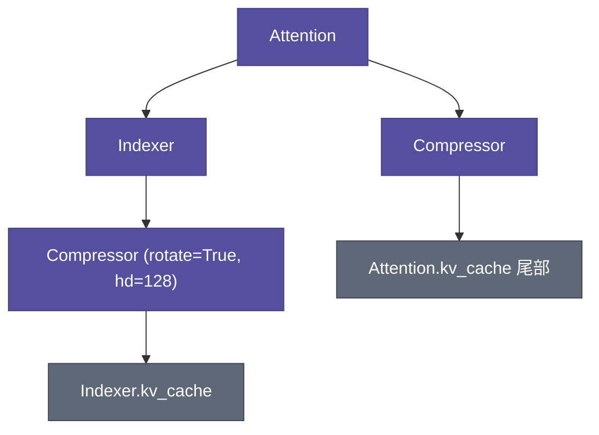
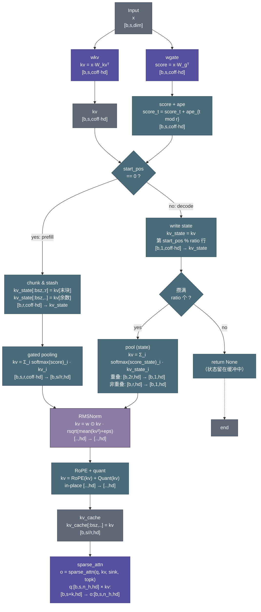

# DeepSeek-V4-Pro Compressor：KV Cache 门控池化压缩器

> - **参考代码：** [`DeepSeek-V4-Pro/inference/model.py`](../../DeepSeek-V4-Pro/inference/model.py) `class Compressor`（第 279–377 行）
> - **配套模块：** `get_compress_topk_idxs`（第 269 行）、`Indexer`（第 380 行）、`Attention`（第 436 行）
> - **说明：** 本文基于推理代码分析，`model.py` 中的默认 `ModelArgs` 为测试规模（7 层），生产配置见 `config.json`。

---

## 1. 模块定位

- **文件**：`DeepSeek-V4-Pro/inference/model.py`
- **类名**：`Compressor`
- **父类**：`nn.Module`
- **上游调用者**：`Attention`（第 467 行创建、第 490–494 行懒加载缓存、第 525/531 行调用 forward）；`Indexer`（第 398 行创建内部 Compressor）
- **下游依赖**：`Linear`（wkv/wgate）、`RMSNorm`、`apply_rotary_emb`、`act_quant` / `fp4_act_quant`、`rotate_activation`、`Attention.kv_cache` / `freqs_cis`（懒加载）
- **核心职责**：把连续 `compress_ratio` 个历史 token 通过学习的门控池化压缩成 1 个 KV 表示，使注意力保持"细粒度近窗 + 粗粒度远史"的双分辨率视野，KV Cache 规模降为 `1/compress_ratio`。

---

## 2. 整体架构与数据流

### 2.1 模块依赖关系



### 2.2 前向计算图（完整版：控制流 + 数据流）

> - 每个节点含三行：节点名称（英文） / 计算公式或操作 / 输入输出维度。**完整版必须画出阶段分支（prefill/decode）、状态缓冲（`kv_state`/`score_state`）的读写、以及提前返回（`return None`）路径**——只画理想单块路径不算完整。



> - **形状标注约定**：节点只写**一个形状**时，表示该模块的**输出维度**；其**输入维度 = 上一个模块的输出维度**（数据流图中上一节点的输出即下一节点的输入，由边隐含）。分叉/合流/形状变换节点则写全 `输入形状 → 输出形状`。

### 2.3 架构模式：CSA 与 HCA

> `model.py` 第 279–282 行的类 docstring 定义了两种用法。

**CSA（Cross-Sliding Attention）**——KV Cache 分为两部分：

| 部分 | 粒度 | 内容 | 索引来源 |
|------|------|------|----------|
| **滑动窗口** | 细粒度 | 最近 `window_size` 个 token | `get_window_topk_idxs` |
| **压缩表示** | 粗粒度 | 历史 token 的门控池化结果 | `get_compress_topk_idxs` 或 `Indexer` |

`sparse_attn` 同时在这两部分上进行稀疏注意力，详见 `Attention.forward`（第 528/533 行）。不同层的 `compress_ratio` 由 `ModelArgs.compress_ratios` 逐层指定。

**HCA（Hierarchical Compressive Attention）**——不同层使用**不同压缩比率**，形成金字塔式层次化结构：

| 层 | ratio | overlap | 语义 |
|----|-------|---------|------|
| 层 2, 4, 6 | 4 | ✅ | 适度压缩，带重叠窗口，保留更多细节 |
| 层 3, 5 | 128 | ❌ | 激进压缩，极大压缩历史 |
| 层 0, 1 | 0 | — | 不压缩，退化为纯滑动窗口注意力 |

> 注意：`ModelArgs.compress_ratios` 元组为 `(0, 0, 4, 128, 4, 128, 4, 0)` 共 8 个元素，但 `n_layers=7`（第 46 行），`Attention.__init__` 中 `compress_ratios[layer_id]`（第 453 行）只读取索引 0–6，**第 8 个元素（索引 7）= 0 是冗余项**，不会生效。

> 设计直觉：**深层（靠近输出）压缩更激进，浅层（靠近输入）保留更多信息**，形成金字塔结构。

**生产配置（config.json）**：

```python
# 61 层配置（n_layers=61，层 id 0–60；与测试规模 7 层不同）：
compress_ratios = [128, 128, 4, 128, 4, 128, ..., 4, 128, 4, 0]  # 62 个元素
#                  └层0,1: 128┘ └── 层2~60: 4/128 交替 ──┘ └索引61: 冗余 0┘
```

生产规模下前两层即激进压缩（128），其后 `4/128` 交替直到最后一层（层 60 = 4）。与测试规模同模式：`compress_ratios` 元组长度（62）比 `n_layers`（61）多一个元素，尾元素 0 是冗余项，运行时只读取索引 0–60。

### 2.4 数据流维度变化总览

| 阶段 | 形状变化 | 说明 |
|------|----------|------|
| 输入 | `[b, s, dim]` | token 隐藏表示（dim=4096 / 生产 7168） |
| wkv / wgate 投影 | `[b, s, coff·hd]` | 每 token 投影出 KV 与门控分数（重叠时 coff=2） |
| 按块分组 | `[b, s//r, r, coff·hd]` | 每 r 个 token 一组（prefill） |
| 门控池化 | `[b, s//r, hd]` | 组内加权融合，压缩为 1 个 KV |
| 输出处理 | `[b, s//r, hd]` | RMSNorm → RoPE → 量化 |
| 写入 kv_cache | `[b, s//r, hd]` | 与窗口 KV `cat` 后进入 `sparse_attn` |

---

## 3. 模块结构：成员变量与子模块

> 本章回答"模块里有什么"，计算逻辑一律放第 4 章。

### 3.1 可学习参数（`nn.Parameter` / 含权重的子模块）

> 可学习参数参与反向传播、随 checkpoint 保存。`wkv` / `wgate` 在 checkpoint 中以 bf16 存储，但这里用 **fp32 参数**，因为门控池化对数值精度敏感（第 295 行注释）。

| 参数 | 类型/形状 | 含义 |
|-----------|-----------|------|
| `self.ape` | `nn.Parameter` `[ratio, coff·hd]` fp32 | 位置编码，加在门控分数上 |
| `self.wkv` | `Linear(dim → coff·hd)` fp32 | 每 token 投影出用于压缩的 KV |
| `self.wgate` | `Linear(dim → coff·hd)` fp32 | 门控分数，控制每 token 在池化中的权重 |
| `self.norm` | `RMSNorm(hd, norm_eps)`（含 weight 参数） | 池化输出归一化 |

> 注意：它直接将 `dim -> coff*head_dim` 而不是先对 `dim` 分头再每头投影，即 KV 上不分多头，只有一个头。Q 侧才分头（见 6.2 职责边界）。

### 3.2 非可学习成员变量（配置属性 / 状态缓冲）

> 非可学习成员不参与梯度：配置属性（int/bool）与 `register_buffer` 缓冲均归此类，缓冲标注 `(buffer)`。

| 成员 | 类型/形状 | 含义 |
|-----------|-----------|------|
| `self.dim` | int = 4096 | 模型隐藏维度，wkv/wgate 的输入维度 |
| `self.head_dim` | int（主路径默认 512；Indexer 内 128） | 压缩 KV 维度 |
| `self.rope_head_dim` | int = 64 | RoPE 旋转维度 |
| `self.nope_head_dim` | int = 448 | 非旋转维度（`head_dim - rope_head_dim`） |
| `self.compress_ratio` | int | 压缩比率 |
| `self.overlap` | bool | `compress_ratio == 4` 时启用重叠窗口 |
| `self.rotate` | bool | 是否做 Hadamard 旋转 + FP4 量化（Indexer 内为 True） |
| `self.kv_state` | `(buffer)` `[max_batch, coff·ratio, coff·hd]` fp32 | decode 增量压缩的状态（布局详解见 3.4） |
| `self.score_state` | `(buffer)` `[max_batch, coff·ratio, coff·hd]` fp32 | 门控分数状态，初始化为 `-inf`（布局详解见 3.4） |
| `self.kv_cache` | 懒加载 tensor（非 buffer，指向 `Attention.kv_cache`） | 压缩 KV 存放位置，自 `Attention.kv_cache` 尾部 |
| `self.freqs_cis` | 懒加载 tensor（非 buffer，指向 `Attention.freqs_cis`） | RoPE 频率表，自 `Attention.freqs_cis` |

### 3.3 `__init__` 输入参数

| 输入参数 | 类型/形状 | 含义 |
|-----------|-----------|------|
| `args` | `ModelArgs` | 配置对象，用到 4 个成员（见下表） |
| `compress_ratio` | int = 4 | 压缩比率：`==4` 时启用重叠窗口，其余（如 128）不重叠 |
| `head_dim` | int = 512 | 压缩 KV 维度。主注意力路径 512；`Indexer` 内 128 |
| `rotate` | bool = False | 是否做 Hadamard 旋转 + FP4 量化（QAT 对齐），仅 Indexer 的 Compressor 为 True |

`args` 在本模块中使用到的成员变量（默认值来自 `ModelArgs`，生产值来自 `config.json`）：

| 成员 | 默认值 / 生产值 | 用途 | 代码出处 |
|------|------------------|------|----------|
| `args.dim` | 4096 / 7168 | `wkv`、`wgate` 的输入维度（`Linear(dim → coff*head_dim)`） | 第 285 行 `self.dim = args.dim`；第 297–298 行投影输入维 |
| `args.rope_head_dim` | 64 | 决定 `nope_head_dim = head_dim - rope_head_dim`，压缩 KV 中仅这部分维度做旋转 | 第 287–288 行 `self.rope_head_dim` / `self.nope_head_dim` |
| `args.norm_eps` | 1e-6 | RMSNorm 的 epsilon：输出归一化 `self.norm` | 第 299 行 `RMSNorm(self.head_dim, args.norm_eps)` |
| `args.max_batch_size` | 4（config 未配置） | 状态缓冲 `kv_state` / `score_state` 的第一维（batch 容量） | 第 303–304 行 `register_buffer` 形状第一维 |

### 3.4 状态缓冲 / 缓存（布局与生命周期详解）

| 缓冲 | 形状 | 作用 |
|------|------|------|
| `kv_state` | `[max_batch_size, coff*ratio, coff*head_dim]` | decode 阶段增量压缩的上一个 KV 状态；prefill 阶段仅赋值 |
| `score_state` | `[max_batch_size, coff*ratio, coff*head_dim]` | 对应的门控分数状态，初始化为 `-inf` |
| `kv_cache` | 懒加载自 `Attention.kv_cache`（第 491 行） | 压缩 KV 的存放位置 |

**这三个缓冲的用途**：不是简单的"临时保存"，而是**流式增量压缩的状态机**——

1. **攒块**：decode 每次只来 1 个 token，而池化需要凑齐 `ratio` 个。token 先写入状态缓冲攒着，攒满（`(start_pos+1) % ratio == 0`）才一次性读出池化；
2. **存"带位置编码的投影"而非裸数据**：`score_state` 写入时已加 `ape`（第 345 行），`kv_state` 存的是 `wkv` 的投影输出（fp32、未压缩）——池化时直接加权求和，**无需重算投影**，这是"增量"省算力的关键；
3. **跨块衔接**：prefill 结尾就把最后一块/尾部余数写入（第 330–335 行），供后续 decode 使用，状态生命周期跨越两个阶段；重叠分支下 `state[:, :ratio]` 保存上一块的投影，池化时与当前块 `cat` 融合（第 350–351 行），池化后滚动（第 353–354 行），实现块边界平滑。

**与 `kv_cache` 的分工**：`kv_state` / `score_state` 存**压缩前**的中间状态（投影 + 门控分数），只服务池化计算，`sparse_attn` 不可见；`kv_cache` 存**压缩后**的最终 KV，供 `sparse_attn` 读取。两者是流水线的前后两段。

**状态缓冲布局（重叠模式，coff=2）**：`state[:, :ratio]` 是**重叠窗口**，`state[:, ratio:]` 是**当前窗口**（第 302 行注释）。

`state[:, :ratio]`（重叠窗口）保存的是**前一个 r 块（紧邻的上一块）的 token 投影**——是 `wkv`/`wgate` 的输出（fp32、未压缩），**不是**原始 token，也**不是**压缩后的表示。重叠窗口如何写入、滚动、与当前块融合，见 4.3 关键子步骤。

### 3.5 其他成员函数

#### `overlap_transform(tensor, value=0)`（第 307–314 行）

```python
def overlap_transform(self, tensor, value=0):
    # 输入 [b, s//r, r, 2d]，输出 [b, s//r, 2r, d]
    new_tensor = tensor.new_full((b, s, 2*ratio, d), value)
    new_tensor[:, :, ratio:, :] = tensor[:, :, :, d:]   # 当前块普通部分 → 后 r 行
    new_tensor[:, 1:, :ratio, :] = tensor[:, :-1, :, :d]  # 上一块重叠部分 → 前 r 行（错位一格）
    return new_tensor
```

**作用**：让压缩块 `j` 的表示 = 块 `j-1` 的末尾 token（重叠窗口，前 `r` 行）+ 块 `j` 自身的普通窗口（后 `r` 行），实现**跨块边界的平滑过渡**。

```txt
            c-token 0    c-token 1    c-token 2     c-token 3
            |--------|  |--------|  |---------|  |---------|
tensor d:   0  1  2  3  4  5  6  7  8  9  10 11  12 13 14 ..
tensor :d   v  v  v  v  0  1  2  3  4  5  6  7   8  9  10 ..
            └─重叠窗口─┘└─普通窗口─┘
```

---

## 4. `forward`：前向关键路径

> 本模块的**全部计算逻辑**收纳在本章，关键子步骤（池化、重叠变换）作为本章小节展开。
> **完整控制流与数据流总览见 2.2 图**：本章按 2.2 图的分支逐段展开细节（公式、伪代码、行号）。

### 4.1 主流程

```python
x = x.float()                       # 压缩在 fp32 下计算
kv = self.wkv(x)                    # [b, s, coff*d]
score = self.wgate(x)               # [b, s, coff*d]
```

随后按 `start_pos` 分支：`start_pos == 0` 走 **prefill**（4.2.1），否则走 **decode**（4.2.2）。两条分支汇合于 `if not should_compress: return`（第 360–361 行）——未攒满 `ratio` 个 token 时直接返回，`Attention.forward` 据此跳过拼接。

### 4.2 阶段分支

#### 4.2.1 Prefill 阶段（`start_pos == 0`）

处理整个序列，一次性压缩：

```python
should_compress = seqlen >= ratio
remainder = seqlen % ratio          # 尾部余数
cutoff   = seqlen - remainder       # 可被 ratio 整除的长度
offset   = ratio if overlap else 0
```

1. **尾部余数处理**（第 330–336 行）：
   - `overlap` 且 `cutoff >= ratio`：最后一块的前 `ratio` 个 token 的投影分别存入 `kv_state[:bsz, :ratio, :]`（kv）与 `score_state[:bsz, :ratio, :]`（score 加 `ape`），作为下一压缩块的重叠窗口；
   - `remainder > 0`：不足一块的尾部 token 的 kv 存入 `kv_state[:bsz, offset:offset+remainder]`、门控分数存入 `score_state`（加 `ape[:remainder]`），供后续 decode 继续累积；
   - `kv`/`score` 截断到 `cutoff`。
2. **按块分组 + 加位置编码**（第 337–338 行）：
   ```python
   kv    = kv.unflatten(1, (-1, ratio))        # [b, cutoff//r, r, 2d]
   score = score.unflatten(1, (-1, ratio)) + self.ape   # 广播加 ape
   ```
3. **重叠变换**（若 `overlap`，第 339–341 行）：`overlap_transform(kv, 0)` 扩为 `[b, s//r, 2r, d]`；`overlap_transform(score, float("-inf"))` 使重叠副本在 softmax 后权重为 0。
4. **门控池化**（第 342 行）：`(kv * score.softmax(dim=2)).sum(dim=2)` → `[b, s//r, d]`。

#### 4.2.2 Decode 阶段（`start_pos > 0`）——增量流式压缩

每次只来 1 个 token，先写入状态缓冲，攒满 `ratio` 个再一次性池化：

```python
should_compress = (start_pos + 1) % compress_ratio == 0
score += self.ape[start_pos % ratio]          # 逐位置编码
```

**重叠分支**（第 346–354 行）：

1. **写入**：`kv_state` / `score_state` 第 `(ratio + start_pos % ratio)` 行；
2. **池化**（攒满时）：`cat([重叠窗口前 r 行前 d 维, 当前窗口后 r 行后 d 维])` → `[b, 2r, d]` → softmax 池化 → `[b, 1, d]`；
3. **滚动**：`kv_state[:bsz, :ratio] ← kv_state[:bsz, ratio:]`，当前窗口移入重叠窗口。

**非重叠分支**（第 355–359 行）：

1. **写入**：`kv_state` / `score_state` 第 `(start_pos % ratio)` 行；
2. **池化**（攒满时）：`(kv_state * score_state.softmax(dim=1)).sum(dim=1, keepdim=True)` → `[b, 1, d]`。

### 4.3 关键子步骤

#### 门控池化（Gated Pooling）

压缩块内加权融合，softmax 保证权重和为 1：

$$
c_j = \mathrm{RMSNorm}\left(\sum_{i=0}^{r-1} \frac{e^{s_{j,i}}}{\sum_k e^{s_{j,k}}} \cdot kv_{j,i}\right), \quad s = wgate(x) + ape
$$

代码实现三处（prefill 第 342 行 / decode 重叠第 352 行 / decode 非重叠第 359 行）：

```python
kv = (kv * score.softmax(dim=2)).sum(dim=2)   # prefill: [b, s//r, r, 2d] → [b, s//r, d]
```

#### 重叠窗口机制（decode 增量融合）

> 一次池化实际融合了 **2r 个 token**：前 r 个来自上一块（重叠窗口），后 r 个来自当前块，这正是重叠（hop=r、window=2r）的含义。

```python
kv_state = torch.cat([self.kv_state[:bsz, :ratio, :d],   # 前一块的 r 个 token（前 d 维）
                      self.kv_state[:bsz, ratio:, d:]],  # 当前块的 r 个 token（后 d 维）
                     dim=1)  # → [b, 2r, d]，2r 个 token 一起门控池化
```

**具体例子（ratio=4）**：

| 阶段 | 重叠窗口 `state[:, :4]` | 当前窗口 `state[:, 4:]` |
|------|------------------------|------------------------|
| 处理 token 12–15（第 4 块）时 | token 8–11 的投影 | token 12–15 的投影 |
| 第 4 块攒满池化后 | ← 滚动 ← token 12–15 | （空，等待写入） |
| 处理 token 16–19（第 5 块）时 | token 12–15 的投影 | token 16–19 的投影 |
| 第 5 块攒满池化时 | 取 token 12–15 的**前 d 维** | 取 token 16–19 的**后 d 维** → 融合出 1 个压缩 KV（覆盖 8 个 token） |

> **易混淆点**：为什么池化时重叠窗口只取 `:d`（前 d 维）？因为 coff=2 时每个 token 投影出两份：**前 d 维是"重叠角色"**（要传给下一个块复用），**后 d 维是"普通角色"**（只在本块池化时用一次）。上一块的后 d 维在它自己那一轮池化时已用过，滚动后不再使用；保留在 `state[:, :ratio]` 里的完整 `2d` 投影中，只有前 d 维会在下一轮被取用。对应第 296 行注释（"When overlap, the first half of dims is for overlapping compression, second half for normal."，即"前 head_dim 维用于重叠压缩，后 head_dim 维用于普通压缩"）。

**重叠窗口的写入与滚动**：
- prefill 结束时（第 330–332 行）：把序列**最后一块**的 r 个 token 投影存入 `kv_state[:bsz, :ratio]`，作为下一压缩块的重叠窗口；
- decode 每攒满一块后（第 353–354 行）：`kv_state[:bsz, :ratio] = kv_state[:bsz, ratio:]`，把刚结束的"当前窗口"整体滚动为新的重叠窗口。

### 4.4 输出处理：归一化 → RoPE → 量化 → 写入缓存

```python
kv = self.norm(kv.to(dtype))                  # RMSNorm，恢复 bf16
# RoPE 频率（按压缩块位置取）：
freqs_cis = self.freqs_cis[:cutoff:ratio]     # prefill
freqs_cis = self.freqs_cis[start_pos + 1 - compress_ratio].unsqueeze(0)  # decode
apply_rotary_emb(kv[..., -rd:], freqs_cis)    # 只旋转 RoPE 维度
if self.rotate:                               # Indexer 的 compressor
    kv = rotate_activation(kv)                # Hadamard 旋转散布离群值
    fp4_act_quant(kv, fp4_block_size, True)   # FP4 量化对齐 QAT
else:                                         # 主注意力 compressor
    act_quant(kv[..., :-rd], 64, scale_fmt, scale_dtype, True)  # 非 RoPE 维 FP8 模拟
```

写入 KV Cache（第 373–377 行）：

```python
if start_pos == 0:
    self.kv_cache[:bsz, :seqlen // ratio] = kv     # prefill 一次写满
else:
    self.kv_cache[:bsz, start_pos // ratio] = kv.squeeze(1)  # decode 逐槽写入
```

---

## 5. 特殊设计

> 本章回答"工程上为什么这样做"，只写与通用实现不同的地方。

### 5.1 量化相关

- **双精度策略**：门控池化对数值精度敏感 → `wkv`/`wgate` 用 fp32 参数、`forward` 内转 fp32 计算，输出再回 bf16（第 295、321–322 行）。
- **量化对齐 QAT**：非 RoPE 维度走 `act_quant`（主路径 FP8 模拟）或 `fp4_act_quant`（Indexer 路径），RoPE 维度保持 bf16 以保证位置精度（第 505 行注释）。

### 5.2 分布式相关

（本节不适用：Compressor 自身无 TP 分片逻辑；其 `kv_cache` 为全局共享 buffer，由 `Attention` 统一管理。）

### 5.3 缓存/状态管理

- **状态缓冲实现流式压缩**：decode 阶段 token 先攒在 `kv_state`/`score_state`，攒满 `ratio` 个才池化输出，无需重算历史。
- **kv_cache 复用**：懒加载自 `Attention.kv_cache` 的 window 段之后（第 491 行），与窗口 KV 共享同一 buffer 的不同区间。
- **循环写入**：prefill 一次写满 `[bsz, :seqlen//ratio]`；decode 按 `start_pos // ratio` 逐槽写入。

---

## 6. 与论文或相邻模块的对照

### 6.1 与论文的对照

（本节不适用：Compressor 为 DeepSeek-V4 的工程实现，尚无公开论文逐条对照。）

### 6.2 与相邻模块的职责边界

**Q / K / V 的多头职责边界**——Compressor 本身**不感知多头**：它处理的是整份隐藏表示，产出的是一份与共享 KV 同规格的压缩向量。多头只存在于 Q 侧，由 `Attention` 负责拆头。

| 角色 | 是否多头 | 头数 | 维度 | 代码出处 | 说明 |
|------|----------|------|------|----------|------|
| **Q** | ✅ 多头 | `n_heads`（默认 64 / 生产 128） | `[b, s, n_heads, 512]` | `Attention.forward`（第 497 行） | 低秩投影 `wq_a → q_norm → wq_b` 升维到 `n_heads × head_dim` 后 `unflatten` 拆头，每头独立计算注意力 |
| **K / V** | ❌ 单份共享 | 1（`num_key_value_heads=1`） | `[b, s, 512]` | `Attention.forward`（第 502–503 行，`wkv` + `kv_norm`） | MLA 的共享 latent：K、V 合并为**同一份** 512 维向量，所有 q 头共用 |
| **Compressor** | ❌ 无多头 | —（不拆头、不感知头数） | 输入 `[b, s, dim]` → 输出 `[b, s/r, 512]` | `Compressor`（第 279–377 行） | 把整份隐藏表示（`dim` 维）门控池化为**单份 512 维**压缩 KV；`head_dim=512` 与 `Attention.head_dim` 相同，仅为了与共享 KV 对齐后直接 `cat`（第 525–526 行），并非"某个头的维度" |

> 结论：压缩 KV 与未压缩 KV 规格一致，共同进入同一次 `sparse_attn`（第 528/533 行），被全部 q 头共享；**头数的计算只发生在 Q 侧**（`n_heads`），与 Compressor 无关。

**与 Attention 的协作**（第 490–494、508–514、524–533 行）：

```python
if self.compressor.kv_cache is None:
    self.compressor.kv_cache = self.kv_cache[:, win:]   # 压缩 KV 存 window 段之后
    self.compressor.freqs_cis = self.freqs_cis
```

- **索引生成**：`ratio==4` 的层额外有 `Indexer`（学习式 top-k 选槽）；`ratio==128` 的层用 `get_compress_topk_idxs` 全量索引。两者与 window 索引 `cat` 后交给 `sparse_attn`。
- **prefill**：`compressor(x, start_pos)` 返回非 None 时，压缩 KV 拼接到 `kv` 尾部参与注意力（第 525–526 行）。
- **decode**：只调 `compressor(x, start_pos)` 更新缓存，`sparse_attn` 直接读 `kv_cache`（第 531–533 行）。
- **offset**：压缩索引的列偏移，`start_pos==0` 时为 `kv.size(1)`（当前窗口 kv 长度），否则为 `win`（第 509 行）。

**与 Indexer 的协作**（第 380–433 行）：`Indexer` 内部拥有一个**独立 Compressor**（`compress_ratio=4, head_dim=128, rotate=True`，第 398 行），用它构建用于评分的压缩 KV；query 侧同样做 RoPE + Hadamard 旋转 + FP4 量化（第 413–416 行），保证评分与 QAT 对齐。

---

## 7. 关键设计要点

> 只写"为什么"，不重复"是什么"（"是什么"已在第 3、4 章讲过）。

1. **双分辨率视野**：窗口注意力保近、压缩注意力保远，避免长序列下历史信息被窗口完全丢弃，且 KV 开销只有 `1/ratio`。
2. **门控池化而非平均池化**：用可学习门控（`wgate` + `ape`）加权，让模型自己决定哪些 token 对压缩表示更重要；softmax 保证权重和为 1。
3. **重叠窗口平滑边界**：coff=2 让每个压缩块融合上一块的末尾 token，消除块边界突变；代价是投影维度翻倍。
4. **流式压缩不重算历史**：decode 阶段用 `kv_state`/`score_state` 攒块，攒满才池化，逐 token 生成时零历史重算。
5. **fp32 计算保精度**：门控池化的加权求和对精度敏感，故参数与计算都在 fp32 完成。
6. **压缩位置取块末 token**：压缩 KV 的 RoPE 位置取块内最后一个 token，与 prefill 的 `freqs_cis[:cutoff:ratio]` 对齐，保证 decode 增量时位置语义一致。
7. **量化对齐 QAT**：非 RoPE 维做量化模拟、RoPE 维保留 bf16，既省显存又不损失位置精度。

---

