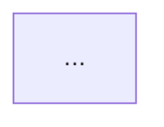
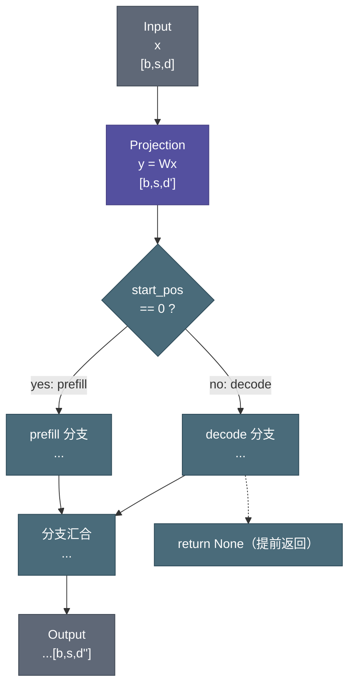

# [模块名] 代码笔记

> - **参考代码：** [`[仓库目录]/[文件名].py`](../../[相对路径]) `class [ClassName]`   
> - **配套模块：** `[函数/类名]`、`[函数/类名]`   
> - **说明：** [基于推理/训练代码分析；默认 `ModelArgs`（测试规模）与生产 `config.json` 的差异等一句话说明]   

<!-- 定位约定：一律用"文件 + 类名/函数名/方法名/变量名"定位，禁止写行号（见 SKILL.md 2.10） -->

<!-- 多 class 笔记（仅限用户显式指定）：主类（组合者/被调用者，如 MoE）写在"参考代码"行首，其余用户指定的 class 逐类并入"配套模块"行并各自注明类名；用户未指定的 class 绝不展开 -->

---

## 1. 模块定位

- **文件**：`[路径]`
- **类名**：`[ClassName]`（多 class 笔记写主类，从类列入下方"从类"字段）
- **从类**：（仅多 class 笔记，用户显式指定的 class）`[FromClass]`——职责 + 与主类的关系
- **父类**：`[BaseClass]`（无则写"无"）
- **上游调用者**：被谁调用（`[调用方]`，写到函数/方法名即可）
- **下游依赖**：调用了哪些子模块/函数
- **核心职责**：一句话说明

## 2. 整体架构与数据流

> 本章回答"模块在整体中处于什么位置、数据怎么流"，**不展开逐行代码实现**（2.2 节点中的公式是数据流/输入输出映射描述，不属于代码细节）。

### 2.1 模块依赖关系



### 2.2 前向计算图（完整版）

每个节点含三行：节点名称（英文） / 计算公式或操作 / 输入输出维度。

> - **完整性要求**（详见 SKILL.md 3.4）：必须画出阶段分支（如 prefill/decode）、状态缓冲（如 `kv_state`）的读写、提前返回（`return None`）路径，并汇合回共同处理节点。**只画理想单块路径不算完整**。
> - **节点规范**（详见 SKILL.md 3.2）：公式写严谨的 `输出 = f(输入)` 且变量名跟随源码；维度按混合策略——**只写一个形状即表示该节点输出维度（输入维度 = 上游输出）**，线性链只写输出形状，分叉/合流/形状变换节点写全 `输入 → 输出`；图内无游离符号。



> 决策节点用菱形 `{}`，提前返回用虚线 `-.->`，分支标签用 `-- "条件" -->`。

### 2.3 数据流维度变化总览

| 阶段 | 形状变化 | 说明 |
|------|----------|------|
| 输入 | [b, s, d] | 原始输入 |
| 经过 A | [b, s, d'] | ... |
| 输出 | [b, s, d''] | ... |

## 3. 模块结构：成员变量与子模块

> 本章回答"模块里有什么"，**不回答"怎么算"**（计算过程一律放第 4 章）。

### 3.1 可学习参数（`nn.Parameter` / 含权重的子模块）

> 可学习参数参与反向传播、随 checkpoint 保存，是"模型的能力"。`Linear`、`RMSNorm` 等含权重的子模块也归此类。

| 所属类* | 参数 | 类型/形状 | 含义 |
|-----------|-----------|-----------|------|
| `MoE` | `self.xxx` | `nn.Parameter` [dim1, dim2] | ... |

*仅多 class 笔记（用户显式指定多个 class）保留此列；单 class 笔记省略"所属类"列，表头恢复三列。

### 3.2 非可学习成员变量（配置属性 / 状态缓冲）

> 非可学习成员不参与梯度：配置属性（int/bool/str）与 `register_buffer` 缓冲都归此类。缓冲须在类型列标注 `(buffer)`。

| 所属类* | 成员 | 类型/形状 | 含义 |
|-----------|-----------|-----------|------|
| `MoE` | `self.xxx` | int / bool / `(buffer)` [dim1, dim2] | ... |

*仅多 class 笔记（用户显式指定多个 class）保留此列；单 class 笔记省略"所属类"列，表头恢复三列。

> ⚠️ 成员变量一定要写全，不能漏掉；**可学习参数与非可学习成员必须分成 3.1、3.2 两个表**，不得混在一个表里。

### 3.3 `__init__` 输入参数

| 输入参数 | 类型/形状 | 含义 |
|-----------|-----------|------|
| `xxx` | [dim1, dim2] | ... |

> 如果遇到打包参数 `args`，需要将使用到了的 `args` 的成员变量也一一列出介绍（每个成员：默认值 / 生产值 + 用途 + 代码出处）。
> 多 class 笔记（用户显式指定多个 class）：与 3.1/3.2 相同——保留"所属类"列（单 class 省略此列）。

### 3.4 状态缓冲 / 缓存（布局与生命周期详解）

> 3.2 已列出缓冲清单，本节对需要展开的缓冲做详细说明（布局、写入/滚动时机、懒加载来源）。

| 缓冲 | 形状 | 作用 |
|------|------|------|

### 3.5 其他成员函数

#### `other_function`

...

## 4. `forward`：前向关键路径

> 本模块的**全部计算逻辑**收纳在本章。关键子步骤（如池化、重叠变换、归一化）作为本章小节展开，**禁止单独成章**。
> **代码块格式**：伪代码须标注语言标记（````python`）；中文夹杂变量/公式的流程描述写成列表段落、变量用行内代码 `xxx`，**禁止用代码块包裹**；禁止裸 ````。

### 4.1 主流程

按执行顺序逐段解释，配合伪代码：

```python
# [b, s, d] → [b, s, d']
# 作用：...
x = self.proj(x)
```

### 4.2 阶段分支（prefill / decode 等）

...

### 4.3 关键子步骤

...

### 4.4 输出处理（归一化 / RoPE / 量化 / 写入缓存）

...

## 5. 特殊设计

> 本章回答"工程上为什么这样做"，只写与通用实现不同的地方。

### 5.1 量化相关
- FP8/FP4 量化的位置和方式
- 哪些部分保留 BF16

### 5.2 分布式相关
- TP 分片策略（行/列并行）
- all-reduce 的位置

### 5.3 缓存/状态管理
- KV cache 的组织方式
- 循环缓冲区 / window 管理
- 状态寄存器的用途

## 6. 与论文或相邻模块的对照

> 对应论文则填 6.1；纯代码模块用 6.2 说明与相邻模块的职责边界（如多头归属）。

### 6.1 与论文的对照

| 项目 | 论文描述 | 代码实现 | 是否一致 |
|------|----------|----------|----------|
| ... | ... | ... | ✅/⚠️/❌ |

### 6.2 与相邻模块的职责边界

| 相邻模块 | 职责/协作方式 | 维度/数据 | 代码出处 | 说明 |
|----------|---------------|-----------|----------|------|

> 用通用字段描述相邻模块如何与本模块协作（职责分工、共享的数据/维度、代码出处）。**代码出处写"文件 + 类/函数名"，禁止写行号**。

## 7. 关键设计要点

> 只写"为什么"，不重复"是什么"（"是什么"已在第 3、4 章讲过）。

- 要点 1：...
- 要点 2：...


---

## 模板使用规则（写给笔记撰写者）

1. **禁止自创顶层章节**：顶层章节只能是上述 1–7；新内容必须放进最接近的现有章节，不得改名或新增。
2. **一章一义**：成员变量/参数表 → 第 3 章；计算逻辑 → 第 4 章；工程细节 → 第 5 章；对照/边界 → 第 6 章；"为什么" → 第 7 章。
3. **不适用的小节**：一律显式标注"（本节不适用）"，**不得删除**；其中第 2 章架构图、第 3 章成员变量、第 4 章 forward 必须保留（无类模块的第 3/4 章标题与第 1 章字段改写规则见文末「非类模块适配表」）。
4. **禁止行号定位（硬约束）**：头部引用块与正文中**不得出现任何源码行号**（"第 X 行"、"L120"、":128" 等），一律用"文件 + 类名/函数名/方法名/变量名"定位。行号会随任何改动漂移，且无法被 `grep` 检索（详见 SKILL.md 2.10）。
5. **撰写流程**：按 SKILL.md「撰写工作流」执行——先做**第 0 步模块拆解**（仅代码仓库笔记，产出模块表 + 索引 `readme.md`）→ 路径建议 → 逐篇产出 `_` 前缀大纲 → 填充 → 删除临时文件并回填索引。「等我审核大纲」才暂停确认，否则默认直接填充。
6. **子模块不展开**：其他模块充当成员变量/输入参数时，不展开子模块，仅简短介绍其中被调用的成员变量和函数的功能（详见 SKILL.md 第 5 节第 8 条）。
7. **笔记结束于第 7 章**：笔记末尾**不得**追加任何模板外的顶层章节（如「关键 Mermaid 绘图说明」）；Mermaid 相关约定已由第 2 章架构图与 SKILL.md 第 3 节覆盖，第 7 章「关键设计要点」即笔记结尾。

---

## 非类模块适配表（流程篇 / Dataset / 纯函数模块）

> 触发条件：模块里**没有类**（流程篇），或主方法**不叫 `forward`**（如 `Dataset.__getitem__`）。
> 规则：只允许按下表**改写第 3 / 4 章的二级标题、并改写第 1 章的字段**，章数仍为 1–7、顺序不变；并在头部"说明"行加一句 `非类模块适配：第 X 章标题替换原因`。除此之外不得改名。

| 章节 | 默认标题（类 + forward） | 非类模块替换为 | 替换条件 |
|------|--------------------------|----------------|----------|
| 1 | 模块定位（类名 / 父类） | 保持标题，字段写"主符号"与"父类：无" | 无类 |
| 3 | 模块结构：成员变量与子模块 | **配置与超参**（`__init__` 参数 → 入口参数 / CLI 参数表） | **仅当无类** |
| 4 | `forward`：前向关键路径 | **`main`：执行关键路径**（流程篇）／ **`__getitem__`：数据集的前向（样本装配）**（Dataset） | 无类 或 主方法非 `forward` |

**第 4 章的 H3 小节也必须一起替换**（否则会留下 `4.2 阶段分支（prefill/decode）`、`4.4 输出处理（归一化 / RoPE / 量化 / 写入缓存）` 这类无关标题）：

| 场景 | 4.1 | 4.2 | 4.3 | 4.4 |
|------|-----|-----|-----|-----|
| 流程篇 | 主流程 | 阶段分支（训练 / 验证·采样） | 关键子步骤（损失组装 / 冻结参数） | 输出处理（日志 / 检查点 / 采样落盘） |
| Dataset | 主流程（读盘 → 抽样子集） | 分支（train 拼接 near / val 只取 vol） | 关键子步骤（随机抽样 / 拼接 / 增广） | 输出处理（dtype / 标签 / 返回元组） |

> 某小节确实不适用时，仍按"（本节不适用）"标注，不删除。

三条硬边界：

- **第 2 章（架构与数据流）与第 5–7 章标题永不替换**；
- 替换后仍须按 SKILL.md 3.4 完整画出真实控制流（流程篇通常有"训练/验证"或"采样/评估"分支）；
- 若模块本来就只有一个类且方法就叫 `forward`，**禁止**使用本表。
