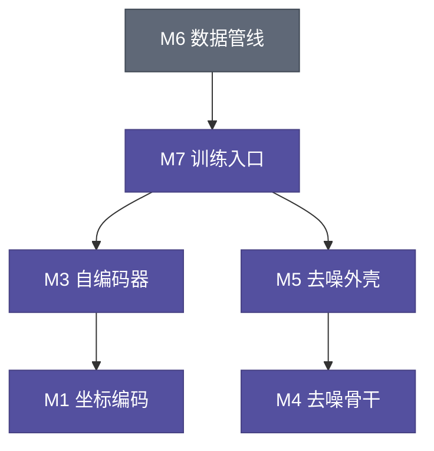

# [仓库名] `src/` 模块分解

> 本文件是**拆解决策的唯一落点**：在写第一篇模块笔记之前生成，之后每新增/删除/合并模块都要同步更新。
> 拆解方法见 note-ai skill 内部的 `references/module-decomposition.md`，单篇笔记模板见其 `templates/code-outline.md`（两者都是 skill 自带文件，不在本仓库内）。
> 定位约定：一律用"文件 + 类/函数/方法/变量名"，禁止写行号。

按「运行时职责 + 依赖方向 + 共同变更原因」切分，而不是按目录或文件机械切分。共 [N] 个模块：

| 编号 | 模块 | 覆盖文件 / 符号 | 所属阶段 | 一句话职责 |
|------|------|-----------------|----------|------------|
| M1 | [模块名] | `[文件]` `[类/函数]` | [阶段/通用] | [一个动词短语，不含 "and"] |
| M2 | ... | ... | ... | ... |

> 判定依据见 `references/module-decomposition.md` §1；粒度是否符合 R1–R5 见同文件 §2。

## 切分说明（只讲为什么）

- **为什么 [A] 与 [B] 分开**：[职责/变更原因不同的一句话理由]。
- **为什么 [C] 独立**：[被 ≥2 个上层复用 / 是论文的关键创新点；对应 R5]。
- **为什么 [D] 合并成一篇**：[1–2 个函数、无独立数据契约，对应 R3]。
- **为什么 [E] 不单独成篇**：[被当成员变量调用，对应 R2；只在 `NN-[调用方].md` 里简短介绍]。

## 依赖关系

> 只画"谁依赖谁"，不画调用时序；节点标签用编号 + 模块名，与上表一致。

## 建议阅读顺序

- **运行顺序**（第一遍读，跟着数据走）：M? → M? → …
- **依赖顺序**（改结构/重训时读，从底层往上）：M? → M? → …

## 笔记索引（按依赖顺序）

| 序号 | 笔记 | 对应模块 |
|------|------|----------|
| 1 | [`NN-[主符号].md`](./NN-[主符号].md) | M?（[模块名]） |
| 2 | ... | ... |

论文层面的动机、公式与实验结论见 [`../[论文笔记].md`](../[论文笔记].md)（若同仓有论文笔记）。

## 维护规则

1. **新增模块**：编号取"当前最大号 + 1"，**不重排**既有编号（重排会让所有相对链接失效）。
2. **合并/删除模块**：保留原编号与文件，在表中标注"（已并入 `NN-xxx.md`）"，不删旧文件直到用户确认。
3. **索引与磁盘必须一一对应**：规划阶段可以先列"计划中的文件名"（此时正式笔记还没写完）；**交付前**必须对照目录列表核一遍"表里的文件都在、磁盘上的笔记都在表里"。
4. **拆解在写笔记之前定稿**：进入填充阶段后只允许微调措辞；若确需重切，先回来改本文件，再回改已写笔记的交叉引用。
5. 本文件不放任何笔记正文内容——它只回答"有几篇、为什么这么分、先读哪篇"。
